<div align="center">

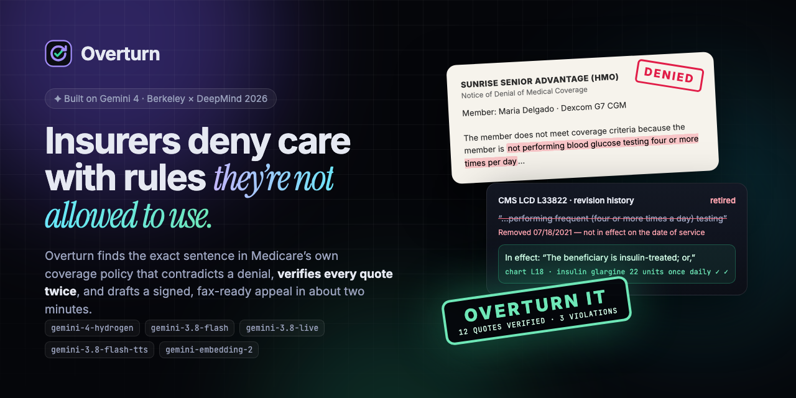

# Overturn

### Appeal Medicare Advantage denials with the insurer’s own rulebook — every quote verified twice.

[](https://vnmoorthy.github.io/overturn/)
[](deck/Overturn-pitch-deck.pptx)
[](https://aistudio.google.com)


**[Live demo](https://vnmoorthy.github.io/overturn/)** · **[How it works](#-how-it-works)** · **[Architecture](#-architecture)** · **[Run locally](#-run-it-locally-2-minutes)** · **[Pitch deck](deck/)** · **[Storyboard](deck/STORYBOARD.md)**

*Berkeley × DeepMind Hackathon 2026 — Google AI Studio track*

</div>

---

## The problem, in three numbers

| | |
|---|---|
| **3.2 million** | Medicare Advantage prior-authorization requests denied in 2023 |
| **11.7 %** | of those denials were ever appealed |
| **81.7 %** | of the appeals were partially or fully overturned |

<sub>Source: [KFF analysis of CMS Medicare Advantage data](https://www.kff.org/medicare/nearly-50-million-prior-authorization-requests-were-sent-to-medicare-advantage-insurers-in-2023/) (2023 data, published 2025).</sub>

That is roughly **2.8 million denials a year that nobody fought** — and most of them would likely have been overturned. Appeals don’t happen because building one is a research job (we estimate 45–60 minutes): find the governing coverage policy, find the version that was in effect on the date of service, line every criterion up against the chart, and quote both precisely. Small practices don’t have the time. Patients don’t know the rules exist.

And the rules are **public**. Medicare Advantage plans are legally bound to Traditional Medicare’s coverage criteria ([42 CFR § 422.101(b)](https://www.ecfr.gov/current/title-42/chapter-IV/subchapter-B/part-422/subpart-C/section-422.101)) — yet denials routinely cite requirements CMS retired years ago, or invent criteria that appear in no policy at all.

## What Overturn does

> Drop in a denial letter and the chart. About two minutes later you have the exact sentence in Medicare’s own rulebook that the denial contradicts, every quote checked twice, the plan’s procedural violations flagged, and a signed, fax-ready appeal.

<table>
<tr>
<td width="50%">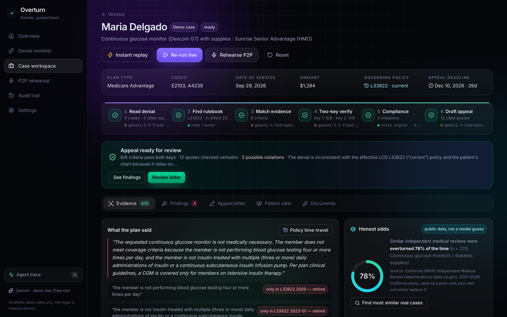<br/><sub><b>Six agents, one run.</b> Live trace of every Gemini call, with automatic fallback.</sub></td>
<td width="50%">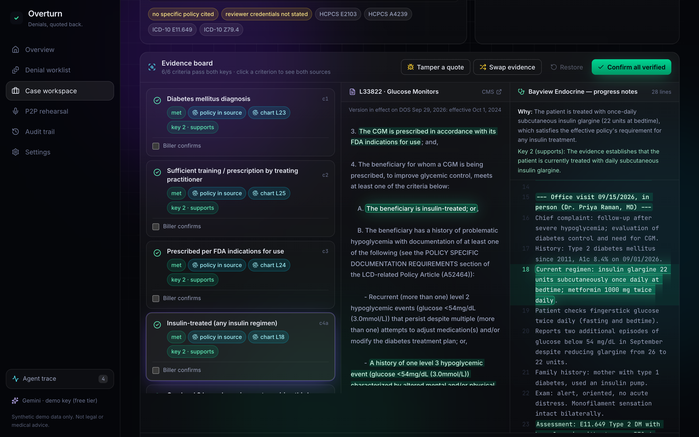<br/><sub><b>Evidence board.</b> Policy sentence ↔ chart line, highlighted side by side.</sub></td>
</tr>
<tr>
<td>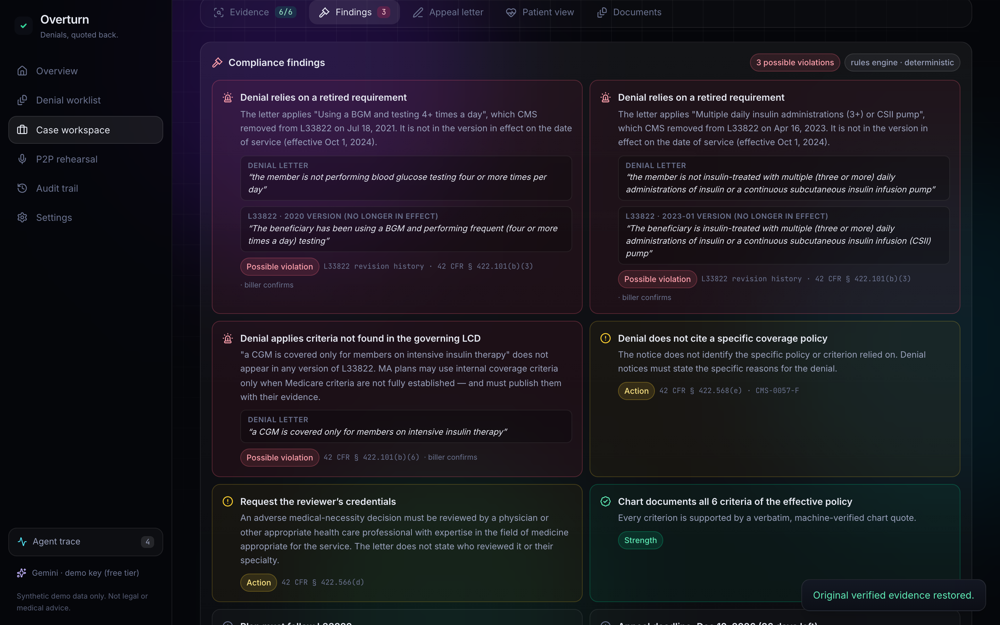<br/><sub><b>Compliance findings.</b> Retired rules, phantom criteria, ignored pathways — decided by code.</sub></td>
<td>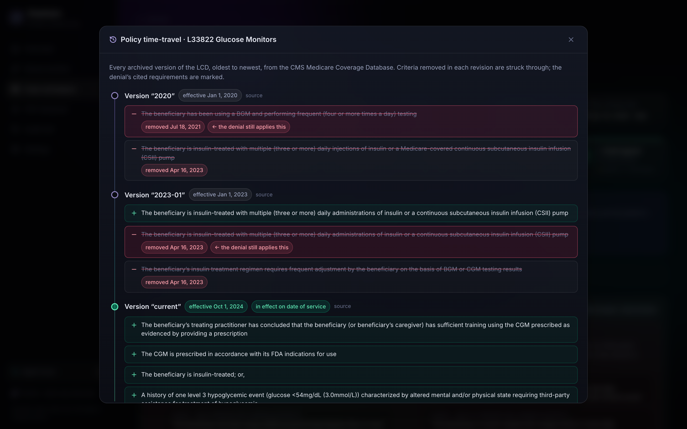<br/><sub><b>Policy time-travel.</b> Every archived LCD version; the denial’s requirement struck through.</sub></td>
</tr>
<tr>
<td>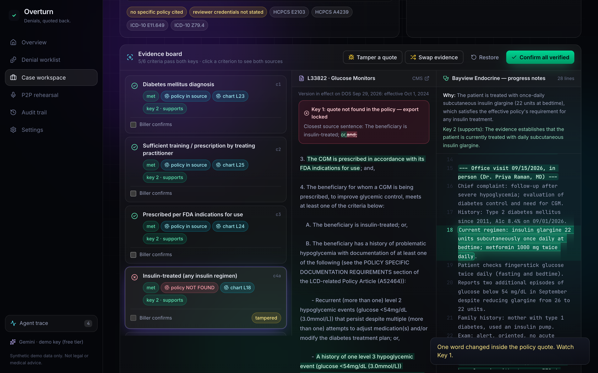<br/><sub><b>Tamper test.</b> Change one word in a quote → Key 1 fails, export locks.</sub></td>
<td>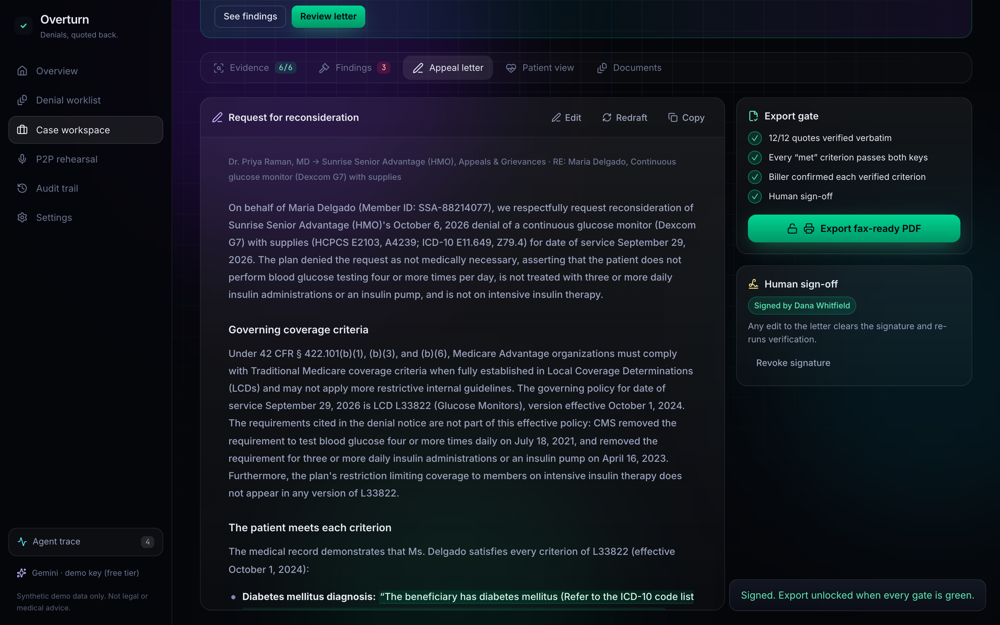<br/><sub><b>Appeal letter.</b> The model can only cite through verified tokens; a human signs.</sub></td>
</tr>
<tr>
<td>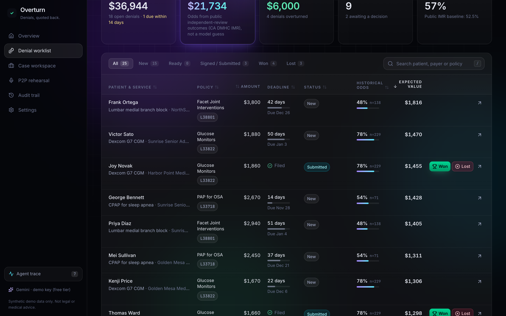<br/><sub><b>Worklist.</b> Every denial ranked by dollars × public overturn odds.</sub></td>
<td>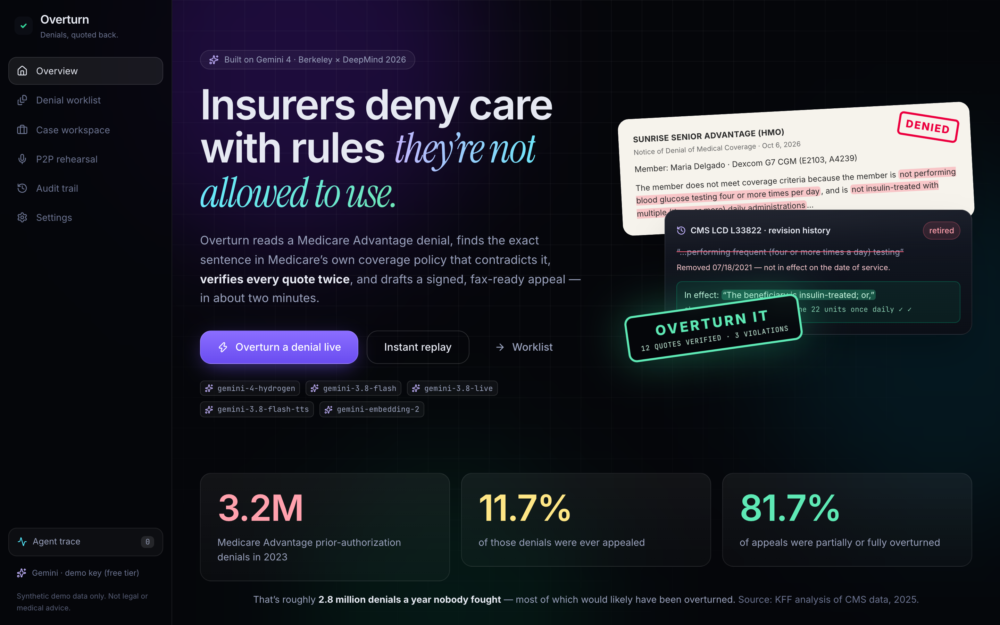<br/><sub><b>Overview.</b> Start a live run, or replay a recorded one instantly.</sub></td>
</tr>
</table>

### The three demo cases (synthetic patients, real CMS policy text)

| Case | What the plan said | What Overturn found |
|---|---|---|
| **Maria — Dexcom G7 CGM** (LCD L33822) | “Not testing four or more times per day”, “not on three or more daily insulin injections” | Both requirements were **removed by CMS** (07/18/2021 and 04/16/2023). A third (“intensive insulin therapy”) appears in **no version** of the LCD. Chart verifiably meets all 6 current criteria. |
| **James — CPAP** (LCD L33718) | “No face-to-face evaluation before the sleep test”, “AHI 12.4 < 15” | Chart line 6 documents the in-person evaluation. The plan **ignored the second pathway**: AHI 5–14 *plus* sleepiness (Epworth 14) and hypertension. Honest gap: supplier-instruction documentation missing. |
| **Linda — lumbar medial branch block** (LCD L38801) | “Pain for at least 6 months”, “12 weeks of physical therapy” | The LCD requires **3 months** of pain; neither the 6-month nor the 12-week rule exists in any version. Honest gap: no baseline disability scale. |

## ✨ Features

- **📸 Multimodal intake** — PDFs with a text layer are read *exactly* with pdf.js (no model). Photos and scans are transcribed verbatim by Gemini. Phone camera capture works out of the box.
- **📚 Policy library with version pinning** — real, verbatim CMS LCD text (93 criteria across 6 versions), routed by HCPCS/CPT code and pinned to the version **in effect on the date of service**.
- **🧠 Long-context criteria match** — one Gemini 4 Hydrogen call reads the effective policy, every historical version, the denial and the line-numbered chart, and returns a criterion-by-criterion table under a strict JSON schema.
- **🔐 Two-key verification**
  - **Key 1 — provenance (deterministic code):** every quote must exist verbatim in its source after normalizing quotes, dashes, ligatures and whitespace. Not found → row turns red, export locks, and the closest source sentence is shown with a word diff.
  - **Key 2 — support (Gemini auditor):** a skeptical second model checks that each chart quote truly establishes its criterion — catching wrong dates, wrong side, negations (“denies…”), and the wrong person (“mother has type 1 diabetes”).
- **⚖️ Deterministic compliance engine** — the LLM supplies features; code decides every flag: retired requirements (policy time-travel), criteria found in no version (42 CFR § 422.101(b)(6)), ignored alternative pathways, denials contradicted by the record, missing specific reasons (§ 422.568(e)), reviewer credentials (§ 422.566(d)), and the 65-day reconsideration deadline (§ 422.582).
- **✍️ Token-cited appeal letter** — the model is not allowed to type a quotation. It writes `[[Q:r2:policy]]` / `[[Q:r2:chart]]` tokens that are expanded into verified quotes. Any other quoted text is re-verified on every keystroke.
- **🚦 Export gate** — the fax-ready PDF (letter + verbatim exhibits A–C) unlocks only when every quote is verified, every “met” criterion passes both keys, the biller confirmed each row, and a human signed.
- **🎙️ Peer-to-peer rehearsal** — practice the P2P call against the plan’s medical director, played live by **Gemini 3.8 Live** over real-time voice, with coach cards built from the verified evidence.
- **💬 Patient view** — a 6th-grade-level explanation in English or Spanish, read aloud by **Gemini TTS**.
- **📊 Honest odds** — no invented probabilities: the overturn rate of **42,710 real independent medical reviews** (CA DMHC open data) for similar services, with *n* shown, plus the most similar real cases via **Gemini Embedding 2**.
- **🗂️ Worklist + payer playbook** — every denial ranked by dollars × public odds; each win or loss compounds into per-payer intelligence.
- **⛓️ Hash-chained audit trail** — every AI step and human decision is SHA-256 chained in the browser. Edit history and *Verify chain* pinpoints the break.
- **🛟 Built for flaky free tiers** — every Gemini call walks a per-task model fallback chain with timeouts (429/503/504 → next model). Demo cases also ship genuine recorded runs, used only as a clearly labeled “cached run” fallback.

## 🔁 How it works

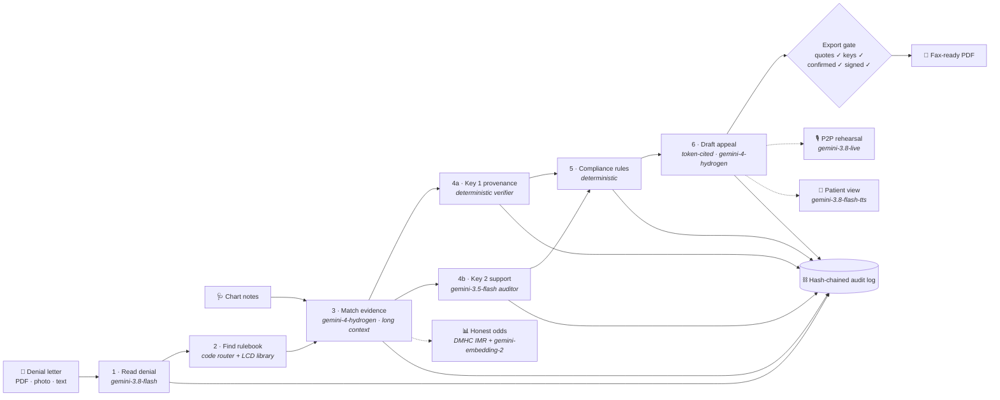

## 🏗️ Architecture

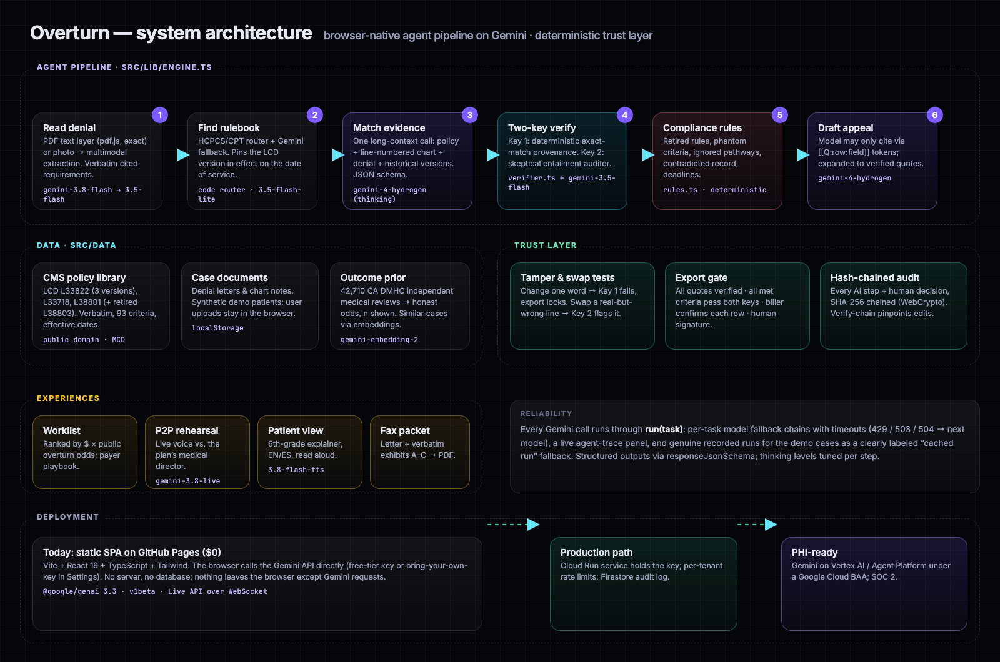

| Layer | What lives there |
|---|---|
| **Agent pipeline** — [`src/lib/engine.ts`](src/lib/engine.ts), [`src/lib/pipeline.ts`](src/lib/pipeline.ts) | Orchestrates extract → locate → match → verify → flag → draft, persists results, writes the audit trail |
| **Gemini gateway** — [`src/lib/gemini.ts`](src/lib/gemini.ts) | `run(task)` with per-task fallback chains, timeouts, thinking levels and a live trace bus |
| **Verifier** — [`src/lib/verifier.ts`](src/lib/verifier.ts) | Unicode-safe normalization with offset mapping, ellipsis-aware matching, closest-sentence + word diff, tamper helper |
| **Rules** — [`src/lib/rules.ts`](src/lib/rules.ts) | Deterministic MA compliance engine and deadline math |
| **Letter** — [`src/lib/letter.ts`](src/lib/letter.ts) | Token expansion, free-quote re-verification, print-ready HTML |
| **Audit** — [`src/lib/audit.ts`](src/lib/audit.ts) | SHA-256 hash chain (WebCrypto), verify, tamper simulation |
| **Data** — [`src/data`](src/data) | Verbatim CMS LCDs ([sources](src/data/policies/README.md)), DMHC IMR aggregates, synthetic cases, recorded runs |
| **UI** — [`src/pages`](src/pages) | Overview, worklist, case workspace, P2P rehearsal, audit trail, settings |

### Gemini models used

| Task | Primary model | Fallbacks | Why |
|---|---|---|---|
| Read the denial (multimodal) | `gemini-3.8-flash` | `gemini-3.5-flash`, `gemini-4-hydrogen` | Fast structured extraction from PDFs/photos |
| Match criteria (long context) | `gemini-4-hydrogen` | `gemini-3.8-flash`, `gemini-3.5-flash` | Reads policy + every historical version + chart in one pass |
| Key 2 support auditor | `gemini-3.5-flash` | `gemini-3.8-flash`, `gemini-4-hydrogen` | Independent, skeptical second opinion |
| Draft the appeal | `gemini-4-hydrogen` | `gemini-3.8-flash` | Token-cited legal-quality prose |
| Patient explainer | `gemini-3.5-flash` | `gemini-3.8-flash` | Plain language, EN/ES |
| Read aloud | `gemini-3.8-flash-tts` | `gemini-3.8-flash-lite-tts` | Natural narration |
| P2P rehearsal | `gemini-3.8-live` | — | Real-time bidirectional voice |
| Similar cases | `gemini-embedding-2` | — | Semantic retrieval over real IMR findings |

## 🚀 Run it locally (2 minutes)

```bash
git clone https://github.com/vnmoorthy/overturn.git
cd overturn
npm install
cp .env.example .env        # add a free key from https://aistudio.google.com/apikey (no billing needed)
npm run dev                 # http://localhost:5173
```

No key? Open **Settings** in the app and paste one — it is stored only in your browser. Or press **Instant replay** on a demo case to replay a genuine recorded run without any API calls.

| Script | What it does |
|---|---|
| `npm run dev` | Vite dev server |
| `npm run build` | Production build to `dist/` |
| `npm run typecheck` | Strict TypeScript check |
| `npm run record-runs` | Re-record genuine Gemini runs for the three demo cases into `src/data/cached/` |

### Deploy (free)

The app is a static SPA. Push to `main` and [`.github/workflows/deploy.yml`](.github/workflows/deploy.yml) builds and publishes to **GitHub Pages**. Optionally add a free-tier `GEMINI_API_KEY` repository secret so visitors can run live without bringing their own key (restrict it to your Pages domain in Google Cloud Console). Production deployments should move the key server-side (Cloud Run) — see below.

## 🛡️ Safety, privacy and honesty

- **Synthetic data only.** All patients, plans, providers and IDs in the demo are fictional. Policy text is real (CMS, public domain).
- **Nothing is stored server-side.** Case data, audit log and keys live in `localStorage`. The only network calls go to the Gemini API.
- **Don’t upload real PHI on the free tier.** Free-tier Gemini API data may be used to improve Google products. The production path is Gemini on **Vertex AI / Gemini Enterprise Agent Platform under a Google Cloud BAA**, with the key held by a Cloud Run service.
- **Human in the loop.** Flags are “possible issues — biller confirms”, never legal conclusions. Nothing is submitted automatically; a person signs every appeal.
- **No fake precision.** Odds are historical rates from public independent-review data with *n* shown — California commercial/Medi-Cal plans, used as a prior until a customer’s own outcomes replace it.
- **Not legal or medical advice.**

## 💼 Why this is a company

- **Who pays:** independent specialty practices (DME, sleep, endocrinology, pain, imaging) and the small billing/RCM firms that serve them — outside the Epic/Waystar bundles.
- **Pricing:** $12 per verified appeal, or 10–15% contingency on recovered dollars (the industry norm for denial recovery).
- **Unit economics:** ~$0.10–0.40 of Gemini inference per appeal → >90% gross margin.
- **Moat:** a versioned graph of every coverage policy + every biller decision and outcome — a *system of judgment* that compounds into per-payer playbooks. Template letter tools don’t capture it.
- **Why now:** CMS-4201-F (2024) binds MA plans to NCD/LCD criteria and forces internal criteria to be public; CMS-0057-F requires specific denial reasons from 2026; and long-context models can finally read a whole policy history and cite it verifiably.

## 🗺️ Roadmap

- [x] Three LCD families, version pinning, policy time-travel
- [x] Two-key verification, deterministic rules, export gate, hash-chained audit
- [x] Live P2P rehearsal, bilingual patient view with TTS
- [ ] All DME MAC + A/B MAC LCDs and NCDs, auto-ingested from the CMS Coverage API
- [ ] Commercial payer clinical policy bulletins (Aetna, UHC, Cigna)
- [ ] 835 remittance / CSV worklist import, fax + portal submission
- [ ] Cloud Run backend, Vertex AI under BAA, SOC 2 Type I
- [ ] Outcome-trained odds replacing the public prior

## 📁 Project structure

```
src/
  lib/          engine · pipeline · gemini · verifier · rules · letter · audit · policies · imr · store
  pages/        Home · Worklist · Workspace (+ workspace/*) · Rehearse · Audit · Settings
  data/         policies/*.json (verbatim CMS LCDs) · imr.json · cases.ts · cached/*.json
  ui/           kit.tsx (design system) · TracePanel.tsx
scripts/        record-runs.ts · screens.mjs · probe-*.mjs
deck/           Overturn-pitch-deck.pptx · STORYBOARD.md
docs/           banner · architecture · screenshots
```

## 🙏 Data sources

- **CMS Medicare Coverage Database** — LCD L33822 *Glucose Monitors* (versions 26, 48, 70), L33718 *PAP Devices for OSA* (v52), L38801 / L38803 *Facet Joint Interventions*. Public domain. See [`src/data/policies/README.md`](src/data/policies/README.md).
- **California DMHC Independent Medical Review Determinations** — 42,710 cases, 2001–2026, CC-BY ([data.ca.gov](https://data.ca.gov/dataset/independent-medical-review-imr-determinations-trend)).
- **KFF** — *Medicare Advantage Insurers Made Nearly 50 Million Prior Authorization Determinations in 2023* (2025).

## License

[MIT](LICENSE) — built for the Berkeley × DeepMind Hackathon, November 2026.

<div align="center"><sub>If Overturn helps you, ⭐ the repo — every star helps a patient find out the rule was retired.</sub></div>
